### Things I've built

### Open source

| Project | What it does | Language |
|---|---|---|
| [near-jsonrpc-kotlin](https://github.com/Gideonjon/near-jsonrpc-kotlin) | Type-safe Kotlin JSON-RPC client for NEAR, generated from the OpenAPI spec | Kotlin |
| [cNGN-Kotlin-SDK](https://github.com/Gideonjon/cNGN-Kotlin-SDK) | Minimal Kotlin SDK for the cNGN stablecoin API | Kotlin |
| [NearScope](https://github.com/Gideonjon/NearScope) | Inspect and debug NEAR smart contracts from your phone | Kotlin |
| [Flutterwave_Integration_Kotlin](https://github.com/Gideonjon/Flutterwave_Integration_Kotlin) | Flutterwave payment integration ported to Kotlin | Kotlin |

### Stack

`Kotlin` `Jetpack Compose` `Coroutines` `Swift` `Flutter` `Dart` `MVVM` `Clean Architecture` `Retrofit` `WebSockets` `Firebase` `WalletConnect` `NEAR` `Base` `TypeScript` `Python`

### Things I've built

### Open source

[near-jsonrpc-kotlin](https://github.com/Gideonjon/near-jsonrpc-kotlin) — type-safe Kotlin JSON-RPC client for NEAR &nbsp;·&nbsp;
[cNGN-Kotlin-SDK](https://github.com/Gideonjon/cNGN-Kotlin-SDK) — Kotlin SDK for the cNGN stablecoin API &nbsp;·&nbsp;
[NearScope](https://github.com/Gideonjon/NearScope) — debug NEAR smart contracts from your phone &nbsp;·&nbsp;
[Flutterwave_Integration_Kotlin](https://github.com/Gideonjon/Flutterwave_Integration_Kotlin) — Flutterwave payments in Kotlin

### Stack

`Kotlin` `Jetpack Compose` `Coroutines` `Swift` `Flutter` `Dart` `MVVM` `Clean Architecture` `Retrofit` `WebSockets` `Firebase` `WalletConnect` `NEAR` `Base` `TypeScript` `Python`

