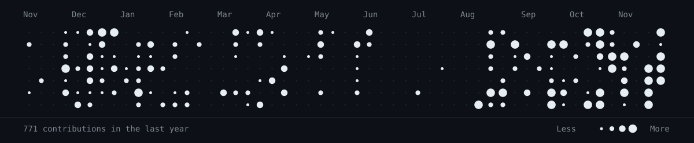

I'm a mobile engineer with **5+ years** of building production Android and iOS apps, mostly in **fintech and Web3**: trading platforms, crypto bill payments, savings apps and payment SDKs. I take products from MVP to production, work closely with product and backend teams, and care about code that's clean, fast and easy to maintain.

**Currently open to full-time, contract and freelance roles.**

---

### 💼 Experience

**Lead Mobile Engineer — [Raba](https://sendraba.xyz)** · *Pay bills with crypto on Base*
- Led the Android app that lets users pay for airtime, electricity, TV and internet with **USDC**, fully non-custodial through **WalletConnect**
- Built the wallet dashboard (balances, token, network), transaction confirmation flow and Firebase token sessions
- Moved all network and image work onto coroutines, which fixed the ANRs found in early testing
- Took the product through its **2024 beta launch**

**Mobile Engineer — [Cafx.io](https://cafx.io)** · *Crypto spot, futures and arbitrage trading*
- Built the entire mobile frontend for a multi-market trading platform that runs in production
- Integrated the REST APIs for spot trading, futures execution and the arbitrage scanner
- Built live market data over **WebSockets** with an API fallback, plus position management and real-time order tracking
- Designed the leverage and margin selection UI and cached markets locally to cut API calls

**Mobile Engineer — [Swap2Naira](https://swap2naira.com)** · *Gift cards to Naira + bill payments*
- Sole mobile developer: built the Android app and integrated it with the custom backend
- Built gift card upload with image compression, payout tracking and bill payments (airtime, data, power, cable)
- Used a modular architecture that keeps swap and bill logic separate, and built an admin flagging system for verifying users

**Mobile Engineer — Etibe** · *Onchain Ajo / group savings on Umi Network*
- Built the full Android app for decentralised rotating savings groups paid in USDC
- Built group creation with custom payout order, public and invite-only groups, and WalletConnect onchain contributions

---

### 🧰 Open source & SDKs

| Project | What it is |
|---|---|
| [near-jsonrpc-kotlin](https://github.com/Gideonjon/near-jsonrpc-kotlin) | Type-safe Kotlin JSON-RPC client for NEAR, generated from the OpenAPI spec, with CI/CD |
| [cNGN-Kotlin-SDK](https://github.com/Gideonjon/cNGN-Kotlin-SDK) | Minimal Kotlin SDK for the cNGN stablecoin API |
| [Flutterwave_Integration_Kotlin](https://github.com/Gideonjon/Flutterwave_Integration_Kotlin) | Kotlin port of the Flutterwave Android payment integration |
| [NearScope](https://github.com/Gideonjon/NearScope) | Mobile-first, backend-free tool for inspecting and debugging NEAR smart contracts |

### 🚀 Recent builds

| Project | Stack | What it does |
|---|---|---|
| [Kontena](https://github.com/Gideonjon/Kontena) | JavaScript | Group buying + trade escrow for importers in Nigeria and Ghana, with funds released at each verified shipment stage |
| [Oja POS](https://github.com/Gideonjon/oja_pos) | Flutter | Point-of-sale app for market traders and POS agents |
| [DuesPay](https://github.com/Gideonjon/DuesPay) | JavaScript | Collects association dues by bank transfer, with a live treasurer dashboard (Paga Collect API) |
| [Leeway](https://github.com/Gideonjon/leeway) | TypeScript | Private cross-chain payments settled in shielded ZEC, live on mainnet |
| [Split Sheet](https://github.com/Gideonjon/split-sheet) | Flutter | Music collaborators sign and timestamp who owns what share of a song |
| [Alert Ledger](https://github.com/Gideonjon/alert_ledger) | Flutter | Turns Nigerian bank SMS alerts into a readable financial record |
| [Perps League](https://github.com/Gideonjon/perps_league) | Flutter | Trading leagues for dreamDEX perpetuals |
| [Polymarket Agent](https://github.com/Gideonjon/Polymarket_Agent) | Kotlin | Agent that trades on Polymarket signals |
| [Realtime STT runner](https://github.com/Gideonjon/vllm-realtime-livepeer-runner) | Python | Real-time speech-to-text on the Livepeer live runner with vLLM |

---

### 🛠 Stack

**Mobile** &nbsp;`Kotlin` `Jetpack` `Coroutines` `Swift` `Flutter` `Dart` 
**Architecture** &nbsp;`MVVM` `Clean Architecture` `Modular apps` `Offline caching` 
**Data & APIs** &nbsp;`Retrofit` `REST` `WebSockets` `JSON-RPC` `Firebase` 
**Fintech & Web3** &nbsp;`WalletConnect` `USDC / stablecoins` `Base` `NEAR` `Flutterwave` `Paga` 
**Also** &nbsp;`TypeScript` `Python` `GitHub Actions`

---

### 📫 Contact

